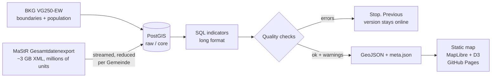

# Solaratlas Pilot

**A self-updating regional data atlas, built on official open data, with automated quality checks against the source.**

**Live map: https://aziziasad.github.io/solar-atlas-pilot/**

The pilot maps rooftop and ground-mounted solar power in Germany: for all 16 Länder, and for one pilot region (Brandenburg) down to Kreis and Gemeinde level. Every week a GitHub Actions workflow downloads the latest official data, rebuilds a PostGIS database, runs a set of quality checks and republishes the map. If an error-level check fails, nothing is published and the previous version stays online.

Solar is the test subject, not the point. The point is the foundation underneath: a data model that extends to every spatial level and to new themes without restructuring, and a pipeline that proves its numbers are right before anyone sees them.

## What it shows

| Indicator | Unit | Why it matters locally |
|---|---|---|
| PV capacity per inhabitant | W/EW | Who takes part in the energy transition, and where |
| PV units per 1,000 inhabitants | units | Spread of ownership, as opposed to a few large parks |
| Share of capacity on buildings | % | Rooftop solar is where households and businesses benefit directly |
| Installed PV capacity | MW | Absolute scale |

## Architecture



* **Sources are discovered, not hardcoded.** Both publishers change file names with every release (export date, schema version). The pipeline reads their download pages and picks the current file.
* **Streaming, not loading.** The MaStR export is parsed file by file with `lxml.iterparse`; each unit is added to a running total per Gemeinde and discarded. Memory stays flat regardless of export size.
* **Codes are resolved from the source.** Status, Bundesland and site type are catalogue IDs in MaStR. They are translated with `Katalogwerte.xml` from the same export, so a catalogue change upstream cannot silently break the filters.
* **One transaction per run.** Load, transform and check happen in a single database transaction. A failed check rolls everything back.

## Data model

```
core.source       where each number comes from: publisher, URL, licence, attribution, reference date
core.area         every Land, Kreis and Gemeinde in ONE table (ags, level, parent_ags, population, geometry)
core.indicator    definitions: name, unit, description, sources
core.observation  long format: (indicator, area, period) -> value, status
raw.*             staged source data
```

Two design choices carry the scaling:

1. **Long format for observations.** A new theme (rents, jobs, wages, infrastructure) is new rows in `core.indicator` and `core.observation`. No new columns, no new tables, and the map and export code stay unchanged.
2. **All levels in one area table, linked by `parent_ags`.** The same SQL aggregates Gemeinde to Kreis to Land. Adding grid cells or Ortsteile means adding a level, not a new pipeline.

`status` exists so that a value which cannot be computed is stored as `missing`, never as `0`.

## Quality checks

The checks run on every update and appear on the map page under *Datenqualität*. They follow four rules.

**1. Reconcile against the source.** The capacity counted while streaming the export must equal the total in the database and the sum over all Länder. Nothing may be lost or double counted between source and map.

**2. Missing is not zero.** Units in operation without a capacity value are counted and reported, never added as 0 kW. Per-head values for an area without population stay empty, with status `missing`. In official statistics the same rule applies to suppressed cells (Destatis marks them `.` or `x`): a pipeline that turns them into 0 publishes wrong numbers for exactly the smallest Gemeinden.

**3. One territorial status.** Gemeinden merge every year. MaStR stores the Gemeindeschlüssel that was valid at registration; the map uses the VG250 status of its reference date. The pipeline measures how much capacity does not match and lists the codes (usually merged Gemeinden). Below 98 % matched capacity the run stops.

**4. Robust outlier detection.** Regional values are heavily skewed: a single solar park can make a rural Kreis look like an error. A mean and standard deviation rule is distorted by the very outliers it should find (masking). The pipeline uses the median and the median absolute deviation (modified z-score above 3.5) and flags areas for review. It never removes them, because an outlier can be real.

| Check | Severity | What it catches |
|---|---|---|
| 16 Länder with geometry and population | error | broken or partial boundary download |
| Source codes still understood | error | schema change upstream (would otherwise publish an empty map) |
| Gemeinde population sums to Land population | error | inconsistent levels |
| Reconciliation with the source stream | error | lost or duplicated capacity |
| Share of capacity without any location | error | unusable records |
| Gemeindeschlüssel match the map's territorial status | error | territorial reforms, wrong codes |
| Units without capacity value | warning | missing values (counted, not zeroed) |
| Bundesland contradicts Gemeindeschlüssel | warning | internal inconsistency in the register |
| National population and capacity in plausible range | warning | wrong file, wrong unit |
| Change against the last published run | warning | sudden jumps between releases |
| Robust outliers among all Kreise | warning | values that need a human look |

**Tested with planted errors.** `tests/make_fixtures.py` builds a small synthetic Germany in the exact formats of both sources (UTF-16 XML, GeoPackage) and plants every problem above: a merged Gemeinde, a missing capacity value, a contradicting Bundesland, a planned and a decommissioned unit, coastal water that must not count as land, and one very large solar park. The tests prove that each check catches its error before the pipeline ever touches live data.

## Run it

**In the cloud (default).** Push to `main`. The workflow runs the tests, then the live pipeline, then deploys to GitHub Pages. In the repository settings, set *Pages → Source* to *GitHub Actions*.

**Locally.**

```bash
docker run -d --name atlas-db -e POSTGRES_PASSWORD=postgres -e POSTGRES_DB=atlas -p 5432:5432 postgis/postgis:16-3.4
pip install -r requirements.txt
python -m tests.make_fixtures && pytest -q     # synthetic data, about a second
python -m pipeline.run                          # live data: downloads ~3 GB, runs 20 to 40 min
python -m http.server -d web 8000               # open http://localhost:8000
```

Settings (pilot region, thresholds, source overrides) are in `pipeline/config.py` and can be set as environment variables, for example `ATLAS_PILOT_LAND=09` for Bayern.

## From pilot to full atlas

* **All Kreise and Gemeinden.** The data is already computed for all of Germany; only the export restricts detail to the pilot region. Nationwide Gemeinde maps (about 10,800 areas) need vector tiles instead of GeoJSON, for example with PMTiles generated in the same workflow.
* **More sources.** Destatis and Regionalstatistik (GENESIS API), Bundesagentur für Arbeit and Zensus 2022 fit the same pattern: a connector in `pipeline/sources/`, a staging table in `raw`, indicator rows in `core`. Their suppressed cells map directly to `status = 'missing'`.
* **Territorial harmonisation.** For time series across reforms, convert older Gemeinde codes with the Destatis change keys before joining, so all periods sit on one territorial status.
* **AI-assisted checks, where they help.** A language model can read source release notes and footnotes and flag definition changes, and draft a plain-language explanation of each flagged anomaly for a person to review. It should not correct data on its own.

## Limits of this pilot

* Kreis and Gemeinde values cover units whose Gemeindeschlüssel matches the map; the check panel states how much that leaves out. Land values are complete.
* Capacity is gross capacity as registered; MaStR registration quality varies, especially for older small units.
* The site type field (on buildings or not) is not filled for every unit; the share is computed only over units where it is known.

## Sources and licences

* Verwaltungsgebiete 1:250 000 mit Einwohnerzahlen (VG250-EW): © BKG, dl-de/by-2-0, Datenquellen: https://sgx.geodatenzentrum.de/web_public/gdz/datenquellen/datenquellen_vg_nuts.pdf
* Marktstammdatenregister, Gesamtdatenexport: © Bundesnetzagentur, dl-de/by-2-0
* MapLibre GL JS (BSD 3-Clause) and D3 (ISC), bundled in `web/vendor/`
* Code in this repository: MIT

## About

Built by Asadullah Azizi with AI-assisted development (Claude). The quality rules apply the approach I use for statistical controlling of a public energy-consumption register: rates with defined denominators, missing kept apart from zero, robust statistics instead of mean and standard deviation, and checks tested on synthetic data with planted errors before launch.
